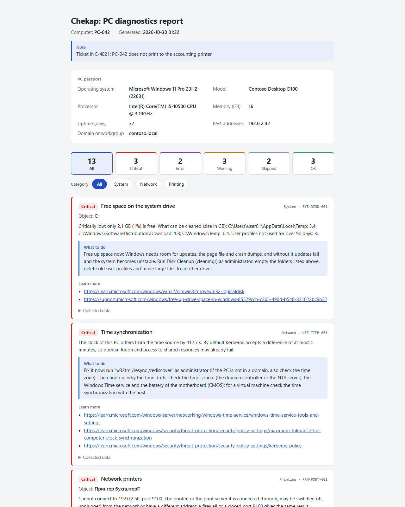

# Chekap

English | [Українська](README.uk.md)

[](https://github.com/Huzdr/chekap/actions/workflows/ci.yml)
[](LICENSE)


**Bilingual (Ukrainian and English) diagnostics for Windows sysadmins: finds common problems with printing, networking and PC health and explains them in plain language.**



*A demo report made from invented data (PC-042, contoso.local, 192.0.2.x). The same report in Ukrainian: [report-uk.png](docs/images/report-uk.png).*

## What it does

- Runs read-only checks of PC health, the network and printing on the PC where it is started. It changes nothing.
- Explains every finding in Ukrainian or English: what was found, what to do about it, and where to read more.
- Saves a report as one HTML file (no internet, no external resources, sends nothing anywhere) and as JSON for scripts.
- Starts by a double click from a flash drive: `Start-Chekap.cmd` opens a console menu, so no commands have to be typed.
- Works on Windows PowerShell 5.1 and PowerShell 7. Needs no other modules and has no telemetry.

Version 0.1 only diagnoses. Fixes, remote runs and CSV are planned (see [Roadmap](#roadmap)).

## Quick start

1. Download `Chekap-0.1.0.zip` from the [Releases](https://github.com/Huzdr/chekap/releases) page.
2. Unblock the zip **before** you extract it: right-click the file, Properties, tick Unblock, OK. Or in PowerShell: `Unblock-File .\Chekap-0.1.0.zip`. Windows marks downloaded files, and PowerShell may refuse to load marked scripts.
3. Extract the zip into a folder on a local disk, a flash drive or a network path like `\\server\share` (not a mapped network drive, see [Known limitations](#known-limitations)).
4. Double-click `Start-Chekap.cmd`. Windows asks for administrator rights (UAC). If you decline, the menu still opens. Choose a check, or item 5 to save an HTML and a JSON report to the `Chekap` folder inside Documents and open the HTML file.

To work in a PowerShell window instead of the menu:

```powershell
Import-Module .\Chekap\Chekap.psd1
Invoke-ChekapAudit -OutputPath C:\Reports
```

If PowerShell says that running scripts is disabled, allow it for this window only: `Set-ExecutionPolicy -Scope Process -ExecutionPolicy Bypass`. The system setting stays as it was.

Installing from the PowerShell Gallery (`Install-Module Chekap`) is planned. It is not available yet.

## Examples

```powershell
# All checks; the findings are printed, the reports go to C:\Reports (the folder is created if needed)
Invoke-ChekapAudit -OutputPath C:\Reports

# A report in English with a note on top: the complaint or a ticket number
Invoke-ChekapAudit -Language en -OutputPath C:\Reports -Note 'INC-4821: PC-042 does not print'

# Only printing, and only what needs attention
Test-ChekapPrinting | Where-Object Status -in 'Warning', 'Critical' | Format-List CheckId, Target, Details, Recommendation

# Only the checks you name; wildcards work
Invoke-ChekapAudit -CheckId 'NET-DNS-*', 'PRN-SPOOLER-001'

# The list of checks, with titles in Ukrainian
Get-ChekapCheck -Language uk

# Ukrainian from now on, for every command and for the menu
Set-ChekapConfig -Language uk
```

`Test-ChekapHealth`, `Test-ChekapNetwork` and `Test-ChekapPrinting` run the checks of one category. Every command returns one object per finding with properties such as `CheckId`, `Category`, `ComputerName`, `Status`, `Target`, `Title`, `Details`, `Recommendation`, `Evidence` and `References`, so the result can be filtered, sorted and exported in PowerShell. The `Status` values are always `OK`, `Warning`, `Critical`, `Error` (the check could not finish) or `Skipped` (the check does not apply, for example there is no battery), in English in any language, so your scripts do not depend on it.

The language of the findings and the report is the `-Language` of the command, otherwise the one saved by `Set-ChekapConfig`, otherwise the language of the Windows interface (Ukrainian if it is Ukrainian, English otherwise). Help for every command is in both languages: `Get-Help Invoke-ChekapAudit -Examples`.

## What it checks

The table is generated from the checks themselves, so it is always complete. The Admin column says whether a check needs administrator rights. In version 0.1 none does; with them some checks see more, for example the folder of crash dumps.

<!-- checks:start -->
| Id | Category | What it checks | Admin |
|---|---|---|---|
| `NET-ADAPTER-001` | Network | Network adapter | no |
| `NET-DHCP-001` | Network | IP address from DHCP | no |
| `NET-DNS-001` | Network | DNS servers | no |
| `NET-DNS-002` | Network | Name resolution | no |
| `NET-GATEWAY-001` | Network | Default gateway | no |
| `NET-INTERNET-001` | Network | Internet access | no |
| `NET-PROFILE-001` | Network | Network profile | no |
| `NET-PROXY-001` | Network | Proxy server | no |
| `NET-TIME-001` | Network | Time synchronization | no |
| `PRN-DEFAULT-001` | Printing | Default printer | no |
| `PRN-DRIVER-001` | Printing | Printer drivers | no |
| `PRN-PORT-001` | Printing | Network printers | no |
| `PRN-QUEUE-001` | Printing | Print queues | no |
| `PRN-RPC-001` | Printing | Shared printers and RPC protection | no |
| `PRN-SCAN-001` | Printing | Imaging devices (scanner or camera) | no |
| `PRN-SPOOLER-001` | Printing | Print Spooler service | no |
| `SYS-APPCRASH-001` | System | Application crashes | no |
| `SYS-BATTERY-001` | System | Battery wear | no |
| `SYS-BSOD-001` | System | Blue screen crashes (BSOD) | no |
| `SYS-DISK-001` | System | Free space on the system drive | no |
| `SYS-MEMORY-001` | System | Memory and page file | no |
| `SYS-PERF-001` | System | CPU and memory load | no |
| `SYS-REBOOT-001` | System | Pending restart | no |
| `SYS-SHUTDOWN-001` | System | Unexpected shutdowns | no |
| `SYS-STARTUP-001` | System | Startup programs | no |
| `SYS-UPTIME-001` | System | Uptime | no |
<!-- checks:end -->

Every finding has a link to the Microsoft documentation it is based on.

## Known limitations

- **Diagnostics only, this PC only.** Version 0.1 changes nothing on the PC and cannot run on other computers.
- **Group Policy and code signing.** If the PowerShell execution policy is set by Group Policy (for example `AllSigned`), it overrides the `-ExecutionPolicy Bypass` of `Start-Chekap.cmd`. Chekap is not code-signed yet, so it will not start there.
- **AppLocker and WDAC.** Under Constrained Language Mode an unsigned module cannot work. Chekap detects this on import and tells you why instead of failing with an obscure error.
- **Windows Server 2016 is best effort.** It is the lowest supported system, but the tests run only on newer Windows, so it is not tested there.
- **Run the launcher from a local folder, a flash drive or a UNC path, not from a mapped network drive.** The elevated session started after the UAC prompt does not see mapped drives.
- **With administrator rights the menu opens the report in a browser that also runs with those rights.** If you do not want that, open the saved HTML file yourself.
- **`Invoke-ChekapAudit` prints the paths of the report files only with `-Verbose`.** The menu (item 5) always saves to `Documents\Chekap`.
- **Look through a report before you send it outside your organization.** It contains the name of the PC, its IP addresses and the names of its printers.

The checks read local data. The network and printing checks also contact the gateway, the DNS servers, the time source, the proxy server if one is set, `www.microsoft.com` (a name lookup and a connection to port 443), and the printers and print servers. Nothing is sent to the authors or to anyone else.

## How it differs

- **[WinUtil](https://github.com/ChrisTitusTech/winutil) (Chris Titus Tech)** is a graphical tool for installing programs and tweaking or debloating one PC, started with `irm | iex`. Chekap is for diagnosing problems: it reads, explains and reports, and it does not install or tweak anything. It is not started from the internet: you download an archive, can read every file and can run it without a network. Fixes with rollback and runs on many PCs are planned, not there yet.
- **[Testimo](https://github.com/EvotecIT/Testimo) and [PingCastle](https://www.pingcastle.com/)** audit Active Directory and security in depth. Chekap does not compete in that depth. It looks at everyday problems of a single PC: printers, network, slowness and crashes. Version 0.1 has no Active Directory checks.
- **Two languages.** Findings, recommendations and reports come in Ukrainian and English from the same checks. Regional packs for Ukraine are planned.

## Roadmap

Planned, not promised. The order and the content can change.

- **0.2:** fixes with `-WhatIf`, a backup of what was changed and a rollback; a before/after comparison of two reports.
- **0.3:** shared folders and NAS (SMB), Windows Update, disks, basic security including the Secure Boot certificates of 2026.
- **0.4:** remote and fleet runs (`-ComputerName`), CSV, `-Anonymize` for sharing a report, your own checks without a fork, OS lifecycle and Windows 11 readiness, everyday domain problems.
- **0.5:** a regional pack for Ukraine, notifications, version 1.0 in the PowerShell Gallery.

## Contributing

A new check is one file and a few lines in each string table: [CONTRIBUTING.md](CONTRIBUTING.md) shows how to add one in about ten minutes. Bug reports, ideas for checks and translation fixes are welcome as [issues](https://github.com/Huzdr/chekap/issues/new/choose). Security problems: [SECURITY.md](SECURITY.md). Please follow the [Code of Conduct](CODE_OF_CONDUCT.md). The wording used in both languages is in the [glossary](docs/glossary.md). Changes are listed in the [changelog](CHANGELOG.md).

## License

[MIT](LICENSE). Author: Denys Huzar ([Huzdr](https://github.com/Huzdr)).
