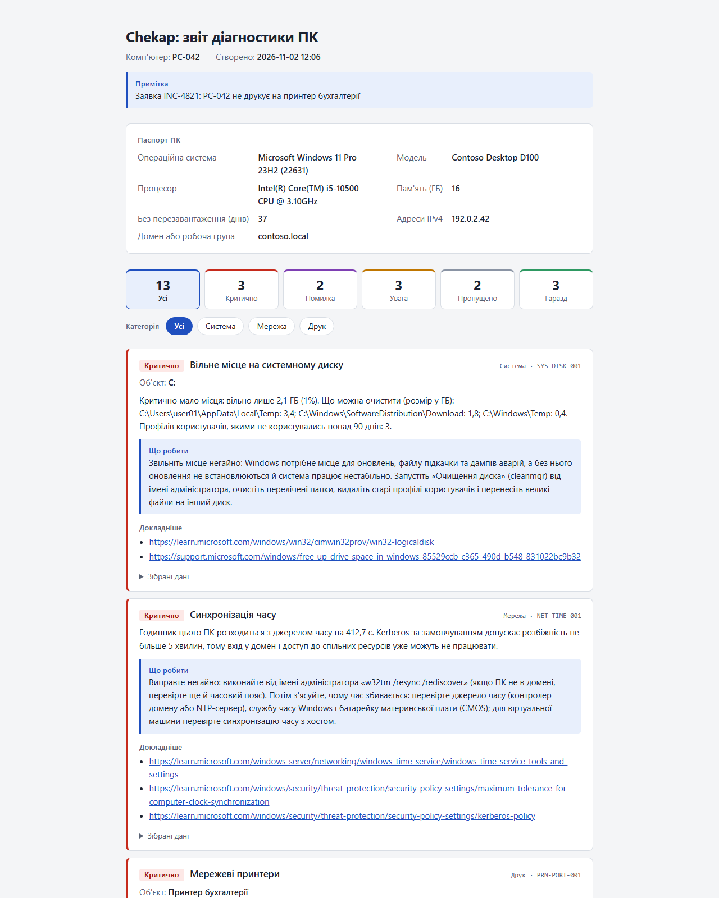

# Chekap

[English](README.md) | Українська

[](https://github.com/Huzdr/chekap/actions/workflows/ci.yml)
[](LICENSE)


**Двомовна (українська й англійська) діагностика для сисадмінів Windows: знаходить поширені проблеми з друком, мережею та станом ПК і пояснює їх простою мовою.**



*Демонстраційний звіт з вигаданих даних (PC-042, contoso.local, 192.0.2.x). Той самий звіт англійською: [report-en.png](docs/images/report-en.png).*

## Що він робить

- Виконує перевірки стану ПК, мережі та друку на тому ПК, де його запущено. Лише читає, нічого не змінює.
- Пояснює кожну знахідку українською або англійською: що знайдено, що з цим робити і де прочитати докладніше.
- Зберігає звіт в одному HTML-файлі (працює без інтернету, без зовнішніх ресурсів, нічого нікуди не надсилає) і в JSON для скриптів.
- Запускається подвійним клацанням з флешки: `Start-Chekap.cmd` відкриває меню в консолі, вводити команди не треба.
- Працює у Windows PowerShell 5.1 і PowerShell 7. Не потребує інших модулів, телеметрії немає.

Версія 0.1 лише діагностує. Виправлення, віддалений запуск і CSV заплановано (див. [Плани](#плани)).

## Швидкий старт

**Підтримувані системи:** Windows 10 22H2, Windows 11 і Windows Server 2016 та новіші (Server 2016 — в міру можливостей); Windows PowerShell 5.1 або PowerShell 7.

1. Завантажте `Chekap-0.1.0.zip` зі сторінки [Releases](https://github.com/Huzdr/chekap/releases).
2. Зніміть блокування з архіву **до** розпакування: клацніть файл правою кнопкою, виберіть «Властивості», позначте «Розблокувати» й натисніть OK. Або в PowerShell: `Unblock-File .\Chekap-0.1.0.zip`. Windows позначає завантажені файли, і PowerShell може відмовитися завантажувати позначені скрипти.
3. Розпакуйте архів у папку на локальному диску, на флешці або у спільну мережеву папку на кшталт `\\server\share`.
4. Двічі клацніть `Start-Chekap.cmd`. Меню відкриється й працюватиме від імені користувача, який увійшов у систему, тож перевірятиме принтери, проксі-сервер і налаштування саме цього користувача. Виберіть перевірку або пункт 5, щоб зберегти звіти HTML і JSON у папці `Chekap` всередині «Документів» і відкрити HTML-файл.

Щоб працювати у вікні PowerShell, а не в меню:

```powershell
Import-Module .\Chekap\Chekap.psd1
Invoke-ChekapAudit -OutputPath C:\Reports
```

Якщо PowerShell повідомляє, що виконання скриптів вимкнено, дозвольте його лише для цього вікна: `Set-ExecutionPolicy -Scope Process -ExecutionPolicy Bypass`. Системне налаштування не зміниться.

Встановлення з PowerShell Gallery (`Install-Module Chekap`) заплановано. Поки що його немає.

## Приклади

```powershell
# Усі перевірки; знахідки виводяться на екран, звіти зберігаються в C:\Reports (папку буде створено, якщо її немає)
Invoke-ChekapAudit -OutputPath C:\Reports

# Звіт англійською з приміткою нагорі: скарга або номер заявки
Invoke-ChekapAudit -Language en -OutputPath C:\Reports -Note 'INC-4821: PC-042 does not print'

# Лише друк, і лише те, що потребує уваги
Test-ChekapPrinting | Where-Object Status -in 'Warning', 'Critical' | Format-List CheckId, Target, Details, Recommendation

# Лише названі перевірки; працюють шаблони з *
Invoke-ChekapAudit -CheckId 'NET-DNS-*', 'PRN-SPOOLER-001'

# Список перевірок із назвами українською
Get-ChekapCheck -Language uk

# Відтепер українською, для всіх команд і для меню
Set-ChekapConfig -Language uk
```

`Test-ChekapHealth`, `Test-ChekapNetwork` і `Test-ChekapPrinting` виконують перевірки однієї категорії. Команди `Test-*` і `Invoke-ChekapAudit` повертають по одному об'єкту на знахідку з властивостями, зокрема `CheckId`, `Category`, `ComputerName`, `Status`, `Target`, `Title`, `Details`, `Recommendation`, `Evidence` і `References`, тож результат можна фільтрувати, сортувати й експортувати в PowerShell. Значення `Status` — завжди `OK`, `Warning`, `Critical`, `Error` (перевірка не змогла завершитися) або `Skipped` (перевірка не стосується цього ПК, наприклад, немає батареї). Вони завжди англійською, незалежно від мови, тож на ваших скриптах вибір мови не позначається.

Мову знахідок і звіту визначає параметр `-Language`; якщо його не вказано — мова, збережена командою `Set-ChekapConfig`; якщо й її немає — мова інтерфейсу Windows (українська, якщо інтерфейс українською, інакше англійська). Довідка до кожної команди є двома мовами: `Get-Help Invoke-ChekapAudit -Examples`. Вона доступна в пакеті релізу, де є зібрані файли довідки; у простому клоні репозиторію їх немає (вихідні тексти довідки лежать у `docs/en` і `docs/uk`).

## Що перевіряє

Таблицю згенеровано з самих перевірок, тож вона завжди повна. Стовпець «Адмін» показує, чи потрібні перевірці права адміністратора. У версії 0.1 вони не потрібні жодній; з ними частина перевірок бачить більше, наприклад папку з дампами аварій.

<!-- checks:start -->
| Id | Категорія | Що перевіряє | Адмін |
|---|---|---|---|
| `NET-ADAPTER-001` | Мережа | Мережевий адаптер | ні |
| `NET-DHCP-001` | Мережа | IP-адреса від DHCP | ні |
| `NET-DNS-001` | Мережа | DNS-сервери | ні |
| `NET-DNS-002` | Мережа | Перетворення імен | ні |
| `NET-GATEWAY-001` | Мережа | Шлюз за замовчуванням | ні |
| `NET-INTERNET-001` | Мережа | Доступ до інтернету | ні |
| `NET-PROFILE-001` | Мережа | Профіль мережі | ні |
| `NET-PROXY-001` | Мережа | Проксі-сервер | ні |
| `NET-TIME-001` | Мережа | Синхронізація часу | ні |
| `PRN-DEFAULT-001` | Друк | Принтер за замовчуванням | ні |
| `PRN-DRIVER-001` | Друк | Драйвери принтерів | ні |
| `PRN-PORT-001` | Друк | Мережеві принтери | ні |
| `PRN-QUEUE-001` | Друк | Черги друку | ні |
| `PRN-RPC-001` | Друк | Спільні принтери та захист RPC | ні |
| `PRN-SCAN-001` | Друк | Пристрої обробки зображень (сканер або камера) | ні |
| `PRN-SPOOLER-001` | Друк | Служба Print Spooler | ні |
| `SYS-APPCRASH-001` | Система | Збої програм | ні |
| `SYS-BATTERY-001` | Система | Знос батареї | ні |
| `SYS-BSOD-001` | Система | Аварії із синім екраном (BSOD) | ні |
| `SYS-DISK-001` | Система | Вільне місце на системному диску | ні |
| `SYS-MEMORY-001` | Система | Пам'ять і файл підкачки | ні |
| `SYS-PERF-001` | Система | Навантаження процесора й пам'яті | ні |
| `SYS-REBOOT-001` | Система | Очікуване перезавантаження | ні |
| `SYS-SHUTDOWN-001` | Система | Аварійні вимкнення | ні |
| `SYS-STARTUP-001` | Система | Програми в автозапуску | ні |
| `SYS-UPTIME-001` | Система | Час безперервної роботи | ні |
<!-- checks:end -->

До кожної знахідки додано посилання на документацію, на якій вона ґрунтується, здебільшого Microsoft.

## Відомі обмеження

- **Лише діагностика, лише цей ПК.** Версія 0.1 нічого не змінює на ПК і не вміє працювати на інших комп'ютерах.
- **Групова політика й підпис коду.** Якщо політику виконання PowerShell задано груповою політикою (наприклад, `AllSigned`), вона має пріоритет над `-ExecutionPolicy Bypass` з `Start-Chekap.cmd`. Chekap ще не підписано, тож там він не запуститься.
- **AppLocker і WDAC.** У режимі обмеженої мови (Constrained Language Mode) непідписаний модуль працювати не може. Chekap виявляє це під час імпорту й пояснює причину, а не завершується незрозумілою помилкою.
- **Windows Server 2016 підтримується в міру можливостей (best effort).** Це найстаріша підтримувана система, але тести виконуються лише на новішій Windows, тож там Chekap не перевірено.
- **`Start-Chekap.cmd` працює від імені користувача, який увійшов у систему, і не просить прав адміністратора.** Тож перевірки бачать принтери, проксі-сервер і налаштування того користувача, у якого виникла проблема, а не іншого адміністратора. Без прав адміністратора папку з дампами аварій прочитати неможливо; якщо вона потрібна, запустіть PowerShell від імені адміністратора самостійно й виконайте `Import-Module .\Chekap\Chekap.psd1; Start-Chekap`.
- **З правами адміністратора меню відкриває звіт у браузері, що теж працює з цими правами.** Якщо вам це не підходить, відкрийте збережений HTML-файл самостійно.
- **`Invoke-ChekapAudit` виводить шляхи до файлів звіту лише з `-Verbose`.** Меню (пункт 5) завжди зберігає звіти в папці `Chekap` всередині «Документів».
- **Перегляньте звіт, перш ніж надсилати його за межі організації.** Окрім імені ПК, його IP-адрес і назв принтерів, у ньому є імена користувачів (у шляху до тимчасової папки та в списку автозавантаження), домен, назва мережі чи Wi-Fi, адреси шлюзу й DNS-серверів, імена джерела часу, контролера домену та серверів друку і назви запущених процесів.

Перевірки читають локальні дані. Мережеві перевірки й перевірки друку також звертаються до шлюзу, DNS-серверів, джерела часу, проксі-сервера (якщо його вказано), `www.microsoft.com` (перетворення імені та з'єднання з портом 443), принтерів і серверів друку. Нічого не надсилається ні авторам, ні комусь іще.

## Чим відрізняється

- **[WinUtil](https://github.com/ChrisTitusTech/winutil) (Chris Titus Tech)** — графічний інструмент для встановлення програм, налаштування й очищення від зайвого на одному ПК; його запускають командою `irm | iex`. Chekap призначений для діагностики проблем: він читає, пояснює й складає звіт, нічого не встановлює й не переналаштовує. Його не запускають з інтернету: ви завантажуєте архів, можете прочитати кожен файл і запускати без мережі. Виправлення з відкатом і запуск на багатьох ПК заплановано, але поки що їх немає.
- **[Testimo](https://github.com/EvotecIT/Testimo) і [PingCastle](https://www.pingcastle.com/)** глибоко перевіряють Active Directory та безпеку. Chekap не змагається з ними в глибині аудиту. Він розв'язує типові щоденні проблеми окремого ПК: з принтерами, мережею, повільною роботою та збоями. У версії 0.1 перевірок Active Directory немає.
- **Дві мови.** Знахідки, рекомендації та звіти українською й англійською — з тих самих перевірок. Регіональні пакети для України заплановано.

## Плани

Заплановано, але не обіцяно. Порядок і зміст можуть змінитися.

- **0.2:** виправлення з `-WhatIf`, резервною копією змін і відкатом; порівняння двох звітів «до/після». Запускач знову запитуватиме права адміністратора, бо їх потребують деякі виправлення.
- **0.3:** спільні папки й NAS (SMB), Windows Update, диски, базова безпека, зокрема сертифікати Secure Boot 2026 року.
- **0.4:** віддалений запуск і запуск на парку ПК (`-ComputerName`), CSV, `-Anonymize`, щоб звітом можна було поділитися, власні перевірки без форку, життєвий цикл ОС і готовність до Windows 11, типові проблеми домену.
- **0.5:** регіональний пакет для України, сповіщення, версія 1.0 у PowerShell Gallery.

## Участь у розробці

Нова перевірка — це один файл і кілька рядків у кожній таблиці рядків: [CONTRIBUTING.uk.md](CONTRIBUTING.uk.md) показує, як додати її приблизно за десять хвилин. Повідомлення про помилки, ідеї перевірок і виправлення перекладу ми приймаємо в [issues](https://github.com/Huzdr/chekap/issues/new/choose). Проблеми безпеки: [SECURITY.md](SECURITY.md). Дотримуйтеся [Кодексу поведінки](CODE_OF_CONDUCT.md). Відповідники термінів у двох мовах зібрано в [глосарії](docs/glossary.md). Зміни перелічено в [журналі змін](CHANGELOG.md).

## Ліцензія

[MIT](LICENSE). Автор: Denys Huzar ([Huzdr](https://github.com/Huzdr)).
